### Hey, I'm dhaern 👋

I'm into computers, video games and astronomy. I enjoy figuring out how things work, building tools I want to use and seeing how much more performance I can get out of software.

- 💻 **Computing & development** — CPU inference, low-level optimization and tools for coding agents.
- 🎮 **Video games & modding** — I enjoy playing games and exploring the technology behind them, especially graphics and rendering.
- 🐛 **Security research** — I take part in bug bounty programs through HackerOne and YesWeHack.
- 🔭 **Astronomy** — stars, distant galaxies and plenty of things I'd like to understand better.

### What I'm working on 🛠️

- **[VelociQ8](https://github.com/dhaern/VelociQ8)** — my CPU inference runtime built on llama.cpp, with the Q8A64 8-bit format and kernels for Arm and x86-64. [Models on Hugging Face](https://huggingface.co/VelociQ8).
- **[better-opencode-tools](https://github.com/dhaern/better-opencode-tools)** — replacements for OpenCode's glob, grep and read tools.
- I collaborate on **[oh-my-opencode-slim](https://github.com/alvinunreal/oh-my-opencode-slim)**, working on agent orchestration and tooling.
- I also contribute to other open-source projects when I find something wrong: bug fixes, refactors and optimizations. I review bugs and assess their severity too.

🛠️ **I play with:**

📊 **Stats:**

  
  

